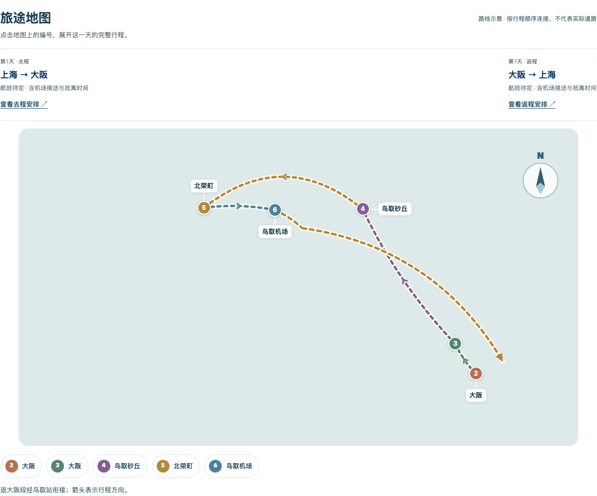

  <strong>AI 自由行规划 · 让想去的地方，成为走得通的旅行计划</strong>

  <a href="https://youli-laura.github.io/way/"><strong>在线体验 Way →</strong></a>
  &nbsp;&nbsp;·&nbsp;&nbsp;
  <a href="docs/PRD.md">产品需求文档</a>
  &nbsp;&nbsp;·&nbsp;&nbsp;
  <a href="docs/testing.md">测试报告</a>

---

## 从旅行想法，到一份可以带走的路书

Way 把体验选择、地图路线和每日安排放在同一份计划中。你可以挑选想去的地方，也可以直接请 Way 排路线；生成后继续调整，最后导出 PDF。

大阪＋鸟取案例的实际界面。地图按行程顺序展示路线，点击日期可查看当天安排。

## 一个 Way，两种使用模式

| 模式 | 怎样体验 | 开放状态 |
| --- | --- | --- |
| **Showcase · 案例体验** | 使用预设旅行条件与案例资料，体验挑选、生成、调整和导出流程 | [在线可用](https://youli-laura.github.io/way/) |
| **Live · 实时规划** | 根据真实输入规划旅行，并继续修改路线与每日安排 | **暂不开放，仅本机可用** |

Showcase 与 Live 属于同一产品，遵循相同的规划规则，在网页顶部切换。

## 一趟旅行，怎样在 Way 里展开

1. **说说想法** — 确认出发地、目的地、天数、同行人和旅行偏好。
2. **挑选体验** — 在地图上选择地点，换一批推荐时保留已选内容。
3. **查看计划** — 一起看全程路线、每日玩法、交通、住宿区域和行前事项。
4. **调整与带走** — 修改或撤销安排，刷新后恢复已保存内容，导出与当前计划一致的 PDF。

## 先从这三趟旅行开始

| 大阪＋鸟取 | 新西兰南岛 | 大理 |
| --- | --- | --- |
| 一个人，逛大阪街区、探访柯南小镇 | 和朋友，自驾探索南岛 | 和父母，慢慢逛、往返不赶路 |
| 约 7 天 · 航班＋铁路＋当地公共交通 | 约 12 天 · 航班＋租车自驾 | 约 7 天 · 航班＋包车／网约车 |

[打开 Way，选择一个案例 →](https://youli-laura.github.io/way/)

案例天数包含往返交通。Showcase 中的航班、住宿和车票均为规划示例；旅行内容保存在当前浏览器。

## 产品文档与验证记录

- [产品需求文档](docs/PRD.md)：定位、功能、使用流程与规划规则。
- [测试报告](docs/testing.md)：Showcase 流程、共同检查与 Live 测试记录。
- [Live 成功样本与通过项](docs/live-testing.md)：真实规划、修改、地图、来源及 PDF 的已验证结果。

---

© 2026 Way. 版权所有。
