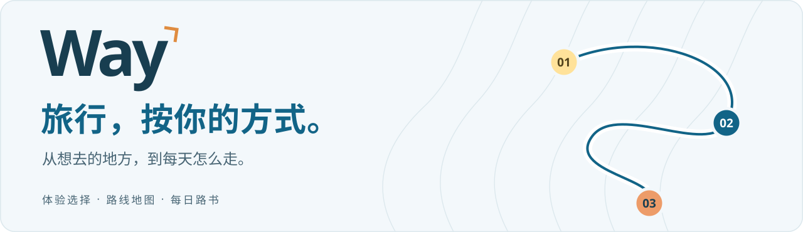
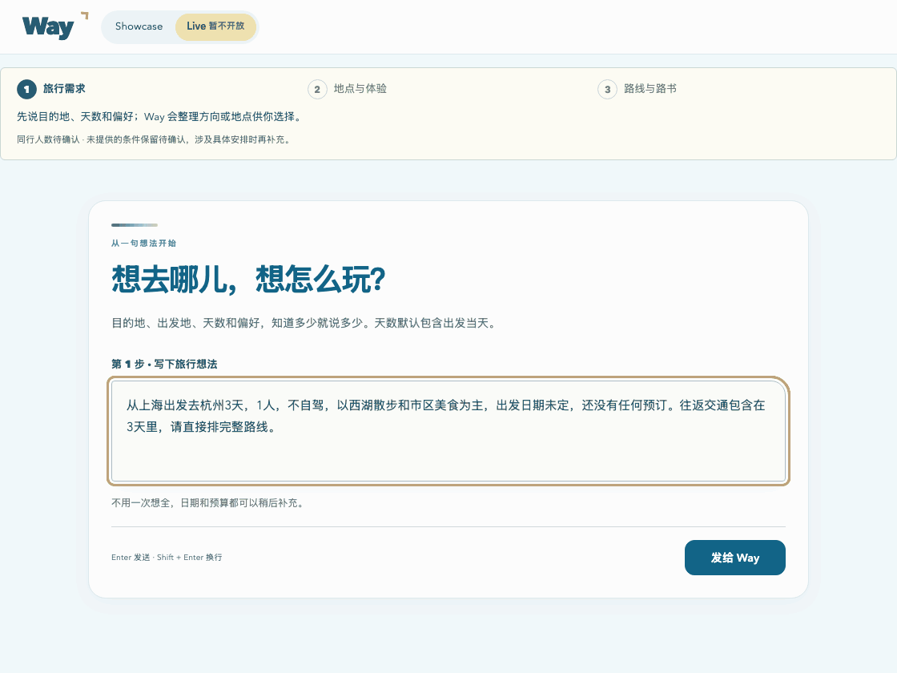
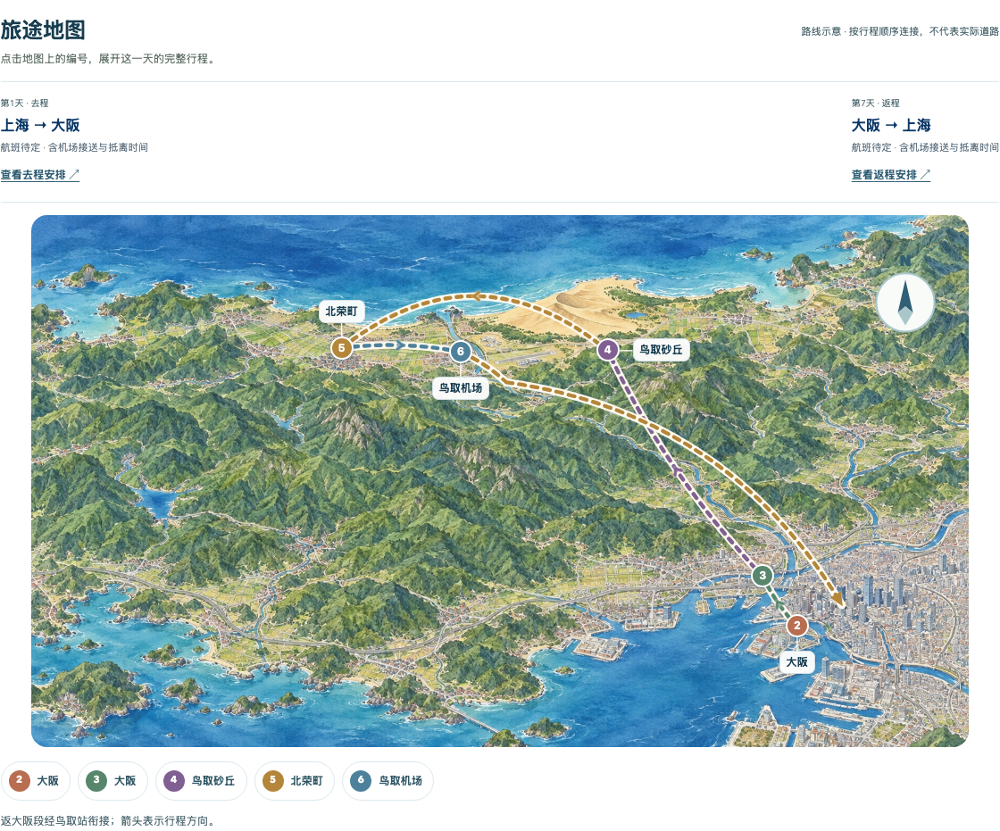

  <strong>AI 自由行规划 · 从旅行想法，到地图路线与每日路书</strong>

  <a href="https://youli-laura.github.io/way/"><strong>体验公开案例 →</strong></a>
  &nbsp;&nbsp;·&nbsp;&nbsp;
  <a href="docs/PRD.md">产品需求文档</a>
  &nbsp;&nbsp;·&nbsp;&nbsp;
  <a href="docs/testing.md">测试报告</a>

---

## Way 做什么

Way 根据你的出发地、目的地、天数与偏好实时规划旅行，把体验选择、地图路线和每日安排放在同一份计划中。生成后可以继续调整，查看交通、住宿区域和行前事项，并导出 PDF。

## 本机真实运行演示

2026-10-15 本机 Live 实际操作片段，使用独立测试旅行。等待与镜头间隔已压缩；动图不代表实时生成速度。

[查看本次演示记录](docs/live-demo.md)

## 目前怎样体验

**Way 的实时规划功能暂不对公众开放，仅本机可用。** 为控制模型调用成本，公开页面提供 Showcase 案例演示，使用预设旅行条件与案例资料，展示选择地点、生成路线、调整安排和导出的完整流程。

Showcase 是 Way 的案例演示入口，网页中的 Live 入口标注“暂不开放”。

| 大阪＋鸟取 | 新西兰南岛 | 大理 |
| --- | --- | --- |
| 一个人，逛大阪街区、探访柯南小镇 | 和朋友，自驾探索南岛 | 和父母，慢慢逛、往返不赶路 |
| 约 7 天 · 航班＋铁路＋当地公共交通 | 约 12 天 · 航班＋租车自驾 | 约 7 天 · 航班＋包车／网约车 |

[打开案例演示 →](https://youli-laura.github.io/way/)

案例天数包含往返交通。航班、住宿和车票均为规划示例；旅行内容保存在当前浏览器。

## 路线与每天的安排放在一起

公开案例的实际界面。地图按行程顺序展示路线，点击日期可查看当天安排。

1. **说说想法** — 确认出发地、目的地、天数、同行人和旅行偏好。
2. **挑选体验** — 在地图上选择地点，换一批推荐时保留已选内容；也可以直接请 Way 排路线。
3. **查看计划** — 一起看全程路线、每日玩法、交通、住宿区域和行前事项。
4. **调整与带走** — 修改或撤销安排，刷新后恢复已保存内容，导出与当前计划一致的 PDF。

## 产品文档与验证记录

- [产品需求文档](docs/PRD.md)：定位、功能、使用流程与规划规则。
- [测试报告](docs/testing.md)：公开案例流程、共同检查与 Live 测试记录。
- [Live 成功样本与通过项](docs/live-testing.md)：真实规划、修改、地图、来源及 PDF 的已验证结果。

---

© 2026 Way. 版权所有。
