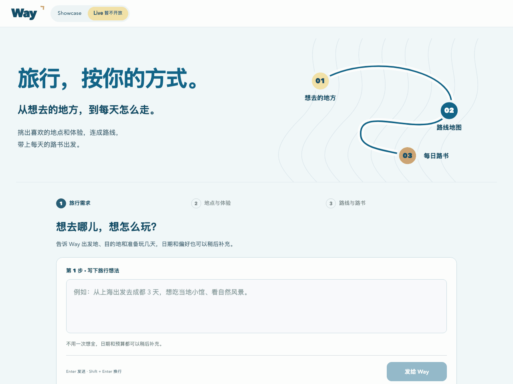

  <a href="https://youli-laura.github.io/way/"><strong>先逛逛案例 →</strong></a>
  &nbsp;&nbsp;·&nbsp;&nbsp;
  <a href="docs/PRD.md">产品需求文档</a>
  &nbsp;&nbsp;·&nbsp;&nbsp;
  <a href="docs/testing.md">测试报告</a>

---

收藏夹里存了不少好地方，真要出发时，还是得重新打开地图：哪些能放在同一天，住在哪里方便，往返路上又要留多久。

Way 把想去的地方、路线和每天的安排放进同一份旅行计划。输入出发地、目的地和天数，选出喜欢的体验，Way 会安排每天的路线、交通和住宿区域。想少去一站，或给某一天多留些时间，直接说明调整要求，地图和路书会随之更新。行程确定后，可以导出 PDF 随身查看。

## 看看一趟旅行是怎么排出来的

下面是作者使用 Way Live 的实际过程：从“上海出发，去杭州玩三天”开始，接着看路线、点开第二天的安排，最后导出路书。

作者在个人电脑上使用 Way Live 的真实操作录屏，录于 2026-10-15。动图约 18 秒，等待片段与镜头间隔已压缩。

[录制过程与实际耗时](docs/live-demo.md)

## 先试试这三趟旅行

- **大阪＋鸟取，约 7 天。** 一个人逛大阪街区、吃点当地小吃，再去砂丘和柯南小镇走走。
- **新西兰南岛，约 12 天。** 和朋友自驾，看山看湖，沿途的小镇也留些时间逛逛。
- **大理，约 7 天。** 陪父母慢慢逛，吃饭、散步、歇一歇，往返也不赶路。

[选一趟，进去看看 →](https://youli-laura.github.io/way/)

**实时规划暂不对公众开放，目前由作者自用。** 为控制模型调用成本，网页先开放 Showcase 案例演示。你可以用预设案例挑地点、排路线、试着调整，再导出 PDF。

案例天数包含往返交通。航班、住宿和车票是规划示例；旅行内容保存在当前浏览器。

## 这一天，去哪里、怎么走

地图上的每个日期，都对应着当天的安排。点开看看：上午去哪儿，下午怎么接着走，交通怎么衔接，有什么需要提前确认。

计划也可以接着商量。想少去一站、把第二天安排得轻松些，就继续告诉 Way。调整时，路线、每天的玩法和相关提醒会一起更新；改完不满意，还可以撤销。实时规划会保存进度，下次可以接着安排；公开案例每次从最新的案例选择页开始。

## 想多了解一点

- [产品需求文档](docs/PRD.md)：Way 想解决什么问题，行程按哪些规则安排。
- [测试报告](docs/testing.md)：案例体验和实时规划已经做过哪些检查。
- [Live 成功样本与通过项](docs/live-testing.md)：真实规划、修改、地图和导出的验证记录。

---

© 2026 Way. 版权所有。
